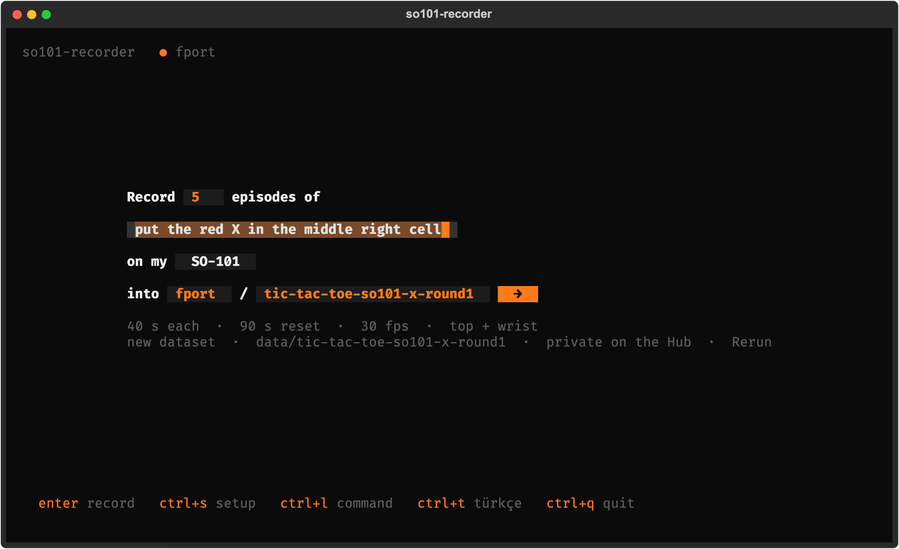
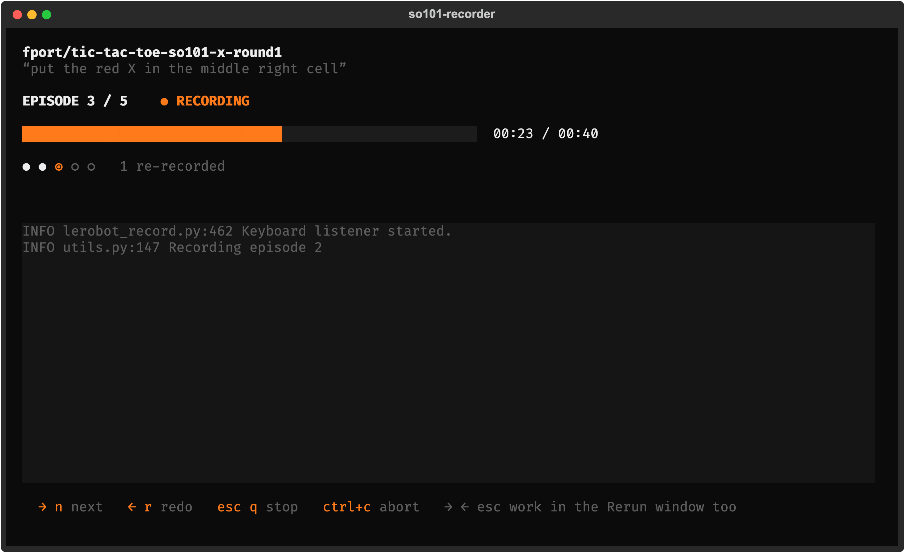
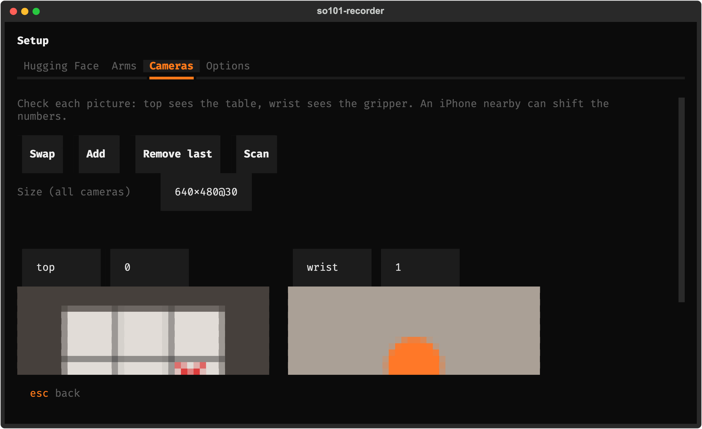

<p align="center"><a href="README.md">English</a> · <a href="README.tr.md">Türkçe</a></p>

<p align="center">
  
</p>

<h1 align="center">so101-recorder</h1>

<p align="center"><b>Record SO-101 datasets by filling in one sentence.</b><br>
<a href="https://github.com/huggingface/lerobot">lerobot-record</a> underneath, Rerun beside it, the Hugging Face Hub at the end. In the terminal. English and Turkish.</p>

<p align="center">
  
  <a href="https://github.com/fport/so101-recorder/actions/workflows/ci.yml"></a>
  <a href="https://github.com/huggingface/lerobot"></a>
  <a href="https://rerun.io"></a>
  <a href="LICENSE"></a>
</p>

## Start

```bash
uv tool install git+https://github.com/fport/so101-recorder   # brings lerobot 0.6 (and torch) with it
so101-rec
```

Fill in the sentence: how many episodes, the task, the dataset name. The first time, **ctrl+s** opens the
setup: log in to Hugging Face, pick which USB port is the follower and which the leader, look at the cameras.
**Enter** starts. The Rerun viewer opens, lerobot says "Recording episode 0", you teleoperate.

| key | while recording |
| --- | --- |
| **→** or **n** | end this episode (or the reset) early |
| **←** or **r** | throw this episode away and record it again |
| **esc** or **q** | stop; the episode in progress is kept, then the push |
| **ctrl+c** | abort (twice: kill) |

The arrows and Esc also work while the Rerun window has focus (on macOS the terminal needs the Accessibility
permission for that; without it they work in the terminal only, and the screen says so).

## Why

`lerobot-record` records well, but every run is a fifteen-flag command, and each project grows its own wrapper
with its own surprises: camera indices that move when an iPhone comes near, a calibration prompt waiting for
ENTER, a dataset folder that already exists, a forgotten `--resume`, a date appended to the name. Here the
setup is remembered, everything is checked before the arm moves, and what runs is still lerobot-record itself.

| | |
| --- | --- |
| 📝 **One sentence** | Record [5] episodes of [task] on my [SO-101] into [user]/[dataset] |
| 🦾 **Native** | lerobot's own parser, record loop, dataset writer, Rerun viewer and push; **ctrl+l** shows the command |
| 🤗 **Hugging Face** | log in once with a token, kept where `huggingface_hub` keeps it; your datasets as suggestions |
| ✅ **Checks first** | ports plugged in, calibration files, camera indices, fps and cameras of an existing dataset |
| ➕ **Resume** | a dataset that is already there gets new episodes added, no flag to remember |
| 📷 **Camera preview** | live, in the terminal; swap top and wrist with one button |
| ⌨️ **Keys counted once** | a held arrow, or one press seen by both the terminal and the global listener, counts once |

<p align="center">
  
  &nbsp;
  
</p>

## More

- **Settings** live in `~/.config/so101-recorder/settings.json` (or `$SO101_RECORDER_HOME`). Datasets go to
  `data/<name>` under the folder you start `so101-rec` in; a project with its own `calibration/` folder (with
  `follower.json` and `leader.json`) is picked up on the first run.
- **`so101-rec --print`** prints the lerobot-record command for the saved settings, to run it by hand.
- **How it works:** the recording runs in a child process,
  [`runner.py`](src/so101_recorder/runner.py), which calls lerobot's `record()` with a few hooks: events on
  stdout for the screen, control words on stdin next to the global keys, the "use the calibration file?"
  prompt answered with ENTER, and one retry when a camera or servo misses its first reply on connect. If the UI
  goes away, the runner stops the way Esc does, so the follower is never left recording alone.
- **No calibration yet?** Use [so101-calibrator](https://github.com/fport/so101-calibrator) or
  `lerobot-calibrate` first.
- **Development:** `uv sync`, `uv run pytest` (the tests run lerobot's real record loop with a stand-in arm,
  no hardware needed), `uv run python tools/screenshots.py` for the pictures above.

## License

MIT
