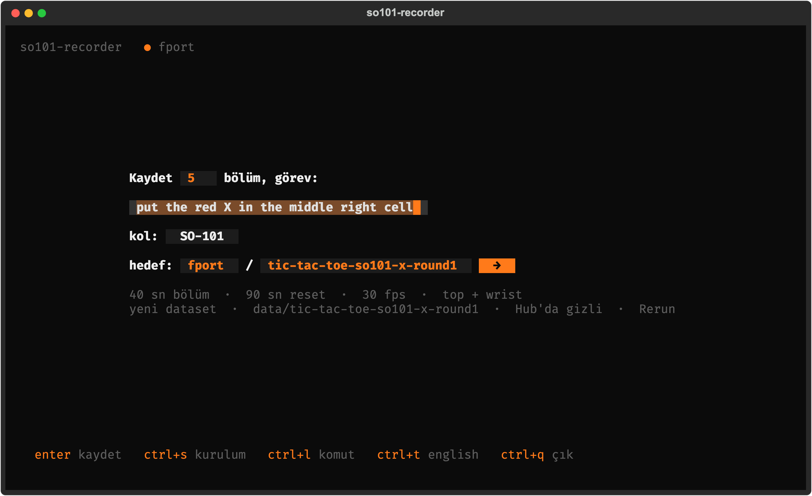
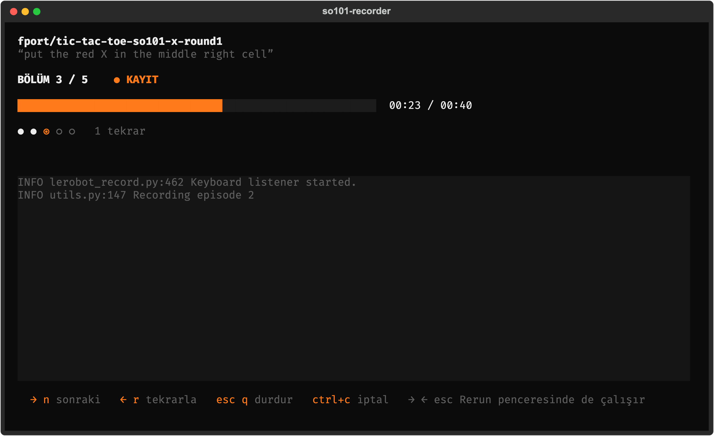
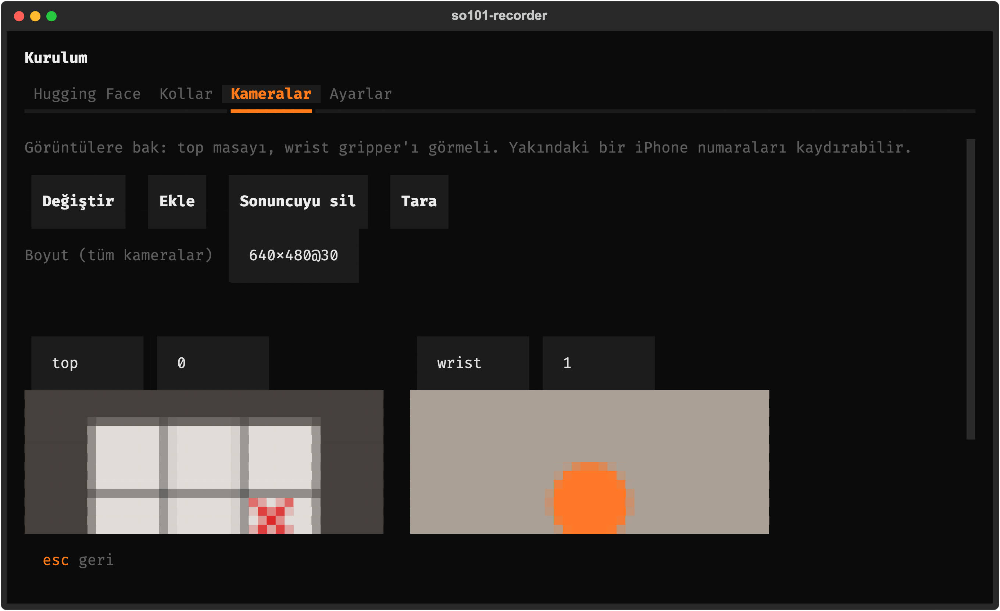

<p align="center"><a href="README.md">English</a> · <a href="README.tr.md">Türkçe</a></p>

<p align="center">
  
</p>

<h1 align="center">so101-recorder</h1>

<p align="center"><b>SO-101 dataset'lerini tek bir cümle doldurarak kaydet.</b><br>
Altta <a href="https://github.com/huggingface/lerobot">lerobot-record</a>, yanında Rerun, sonunda Hugging Face Hub. Terminalde. İngilizce ve Türkçe.</p>

<p align="center">
  
  <a href="https://github.com/fport/so101-recorder/actions/workflows/ci.yml"></a>
  <a href="https://github.com/huggingface/lerobot"></a>
  <a href="https://rerun.io"></a>
  <a href="LICENSE"></a>
</p>

## Başla

```bash
uv tool install git+https://github.com/fport/so101-recorder   # lerobot 0.6'yı (ve torch'u) da kurar
so101-rec --lang tr
```

Cümleyi doldur: kaç bölüm, görev, dataset adı. İlk seferde **ctrl+s** kurulumu açar: Hugging Face'e giriş yap,
hangi USB portun follower hangisinin leader olduğunu seç, kameralara bak. **Enter** başlatır. Rerun açılır,
lerobot "Recording episode 0" der, sen teleop yaparsın.

| tuş | kayıt sırasında |
| --- | --- |
| **→** ya da **n** | bu bölümü (ya da reset'i) erken bitir |
| **←** ya da **r** | bu bölümü at, yeniden kaydet |
| **esc** ya da **q** | durdur; o anki bölüm saklanır, sonra push |
| **ctrl+c** | iptal (iki kez: zorla kapat) |

Oklar ve Esc, Rerun penceresi öndeyken de çalışır (macOS'ta bunun için terminale Erişilebilirlik izni gerekir;
izin yoksa sadece terminalde çalışırlar ve ekran bunu söyler).

## Neden

`lerobot-record` iyi kaydediyor ama her kayıt on beş flag'li bir komut, ve her projede kendi sürprizleriyle
gelen bir sarmalayıcı büyüyor: yakına bir iPhone gelince kayan kamera numaraları, ENTER bekleyen bir kalibrasyon
sorusu, zaten var olan bir dataset klasörü, unutulan `--resume`, ada eklenen tarih. Burada kurulum hatırlanıyor,
kol kıpırdamadan her şey kontrol ediliyor ve çalışan şey yine lerobot-record'un kendisi.

| | |
| --- | --- |
| 📝 **Tek cümle** | Kaydet [5] bölüm, görev: [görev] · kol: [SO-101] · hedef: [kullanıcı]/[dataset] |
| 🦾 **Native** | lerobot'un kendi parser'ı, kayıt döngüsü, dataset yazıcısı, Rerun'ı ve push'u; **ctrl+l** komutu gösterir |
| 🤗 **Hugging Face** | token ile bir kez giriş, `huggingface_hub`'ın sakladığı yerde durur; dataset'lerin öneri olarak gelir |
| ✅ **Önce kontrol** | takılı portlar, kalibrasyon dosyaları, kamera numaraları, var olan dataset'in fps'i ve kameraları |
| ➕ **Devam** | zaten var olan dataset'e yeni bölümler eklenir, hatırlanacak flag yok |
| 📷 **Kamera önizleme** | canlı, terminalde; top ile wrist'i tek tuşla değiştir |
| ⌨️ **Tuş bir kez sayılır** | basılı tutulan ok ya da hem terminalin hem global dinleyicinin gördüğü tek basış bir kez sayılır |

<p align="center">
  
  &nbsp;
  
</p>

## Daha fazla

- **Ayarlar** `~/.config/so101-recorder/settings.json` içinde (ya da `$SO101_RECORDER_HOME`). Dataset'ler
  `so101-rec`'i başlattığın klasörün altında `data/<ad>` içine gider; kendi `calibration/` klasörü olan bir proje
  (`follower.json` ve `leader.json` ile) ilk açılışta tanınır.
- **`so101-rec --print`** kayıtlı ayarların lerobot-record komutunu yazar; elle çalıştırmak için.
- **Nasıl çalışıyor:** kayıt bir alt süreçte, [`runner.py`](src/so101_recorder/runner.py) içinde çalışır;
  lerobot'un `record()`'unu birkaç kancayla çağırır: ekran için stdout'a olaylar, global tuşların yanında
  stdin'den kontrol kelimeleri, "kalibrasyon dosyası kullanılsın mı?" sorusuna ENTER, ve bağlanırken ilk cevabı
  kaçıran kamera ya da servo için bir yeniden deneme. Arayüz kapanırsa runner Esc'e basılmış gibi durur;
  follower hiç tek başına kayıtta kalmaz.
- **Henüz kalibrasyon yok mu?** Önce [so101-calibrator](https://github.com/fport/so101-calibrator) ya da
  `lerobot-calibrate`.
- **Geliştirme:** `uv sync`, `uv run pytest` (testler lerobot'un gerçek kayıt döngüsünü sahte bir kolla
  çalıştırır, donanım gerekmez), yukarıdaki görseller için `uv run python tools/screenshots.py`.

## Lisans

MIT
